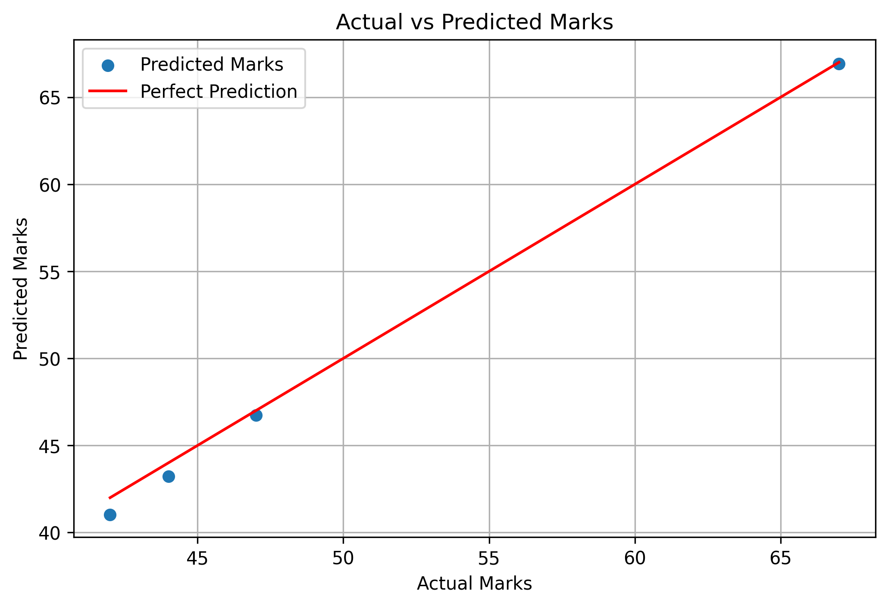
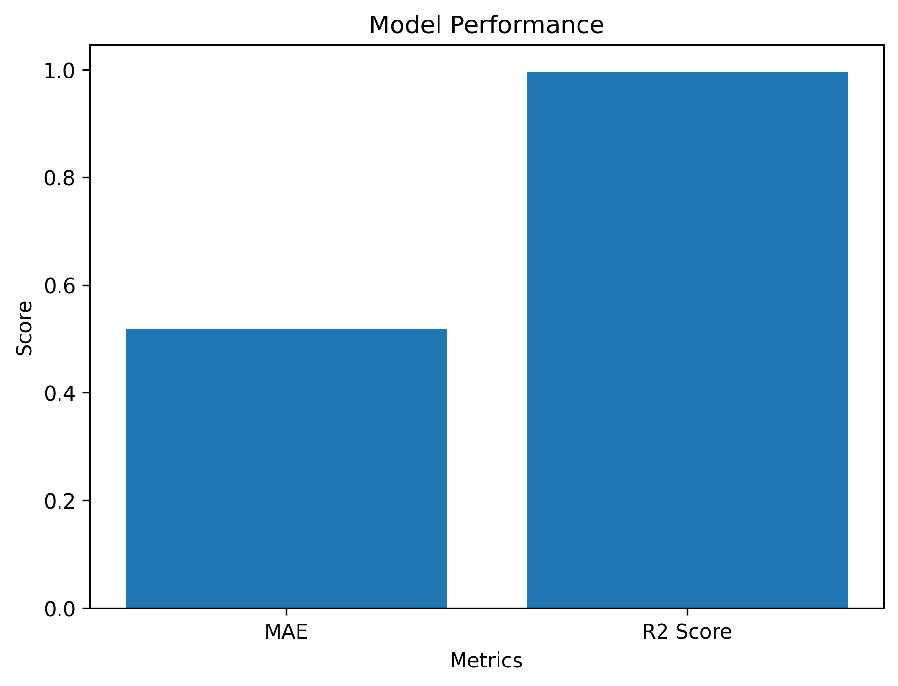

# Student Marks Prediction Using Linear Regression

## Project Overview

This project predicts a student's final marks using Machine Learning.

It uses Linear Regression to predict marks based on:

- Study Hours
- Attendance
- Previous Marks

## Technologies Used

- Python
- Pandas
- NumPy
- Matplotlib
- Scikit-learn

## Dataset

The project uses a sample dataset named "student.csv" containing 20 student records.

## Machine Learning Algorithm

Linear Regression is used to train the model and predict final marks.

## Model Evaluation

The model is evaluated using:

- Mean Absolute Error (MAE)
- R2 Score

Sample results:

- MAE: 0.5177
- R2 Score: 0.9959

Note: These results are based on a small sample dataset and do not represent real-world model performance.

## How to Run the Project

1. Install the required libraries:
   
   "pip install -r requirements.txt"

2. Run the Python file:
   
   "python main.py"

## Project Files

- "main.py" – Main Python code
- "student.csv" – Student dataset
- "requirements.txt" – Required Python libraries
- "README.md" – Project documentation

## Author

Student Marks Prediction Projects
## Project Output

### Actual vs Predicted Marks

### Model Performance

